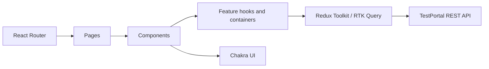

# Codebase Map

> Generated by Cartographer. Last mapped: 2026-11-05T09:16:10Z.

## System Overview

The client is a React and TypeScript SPA built with Vite. React Router selects pages, Chakra UI provides the component system, and Redux Toolkit/RTK Query owns API state. API hooks are generated from the backend OpenAPI document and extended locally for endpoints not covered by generated hooks.

## Directory Structure

- `src/pages/`: route-level page compositions, including Test Management.
- `src/components/`: feature UI and shared UI components.
- `src/redux/apis/`: generated API and extended RTK Query endpoints.
- `src/redux/slices/`: application state outside RTK Query.
- `src/hooks/`, `src/contexts/`: shared React hooks and contexts.
- `src/schemas/`, `src/types/`: runtime schemas and TypeScript contracts.
- `src/theme/`: Chakra theme and semantic tokens.
- `src/utils/`: shared transformations and error helpers.
- `src/__tests__/`: tests organized to mirror source areas.

## Module Guide

### Test Management and scenarios

**Entry point:** `src/pages/TestScenarios/TestScenariosPage.tsx`

| File | Purpose |
| --- | --- |
| `src/pages/TestScenarios/TestManagementTabs.tsx` | Scenarios, Suites, and Manual Runs tab navigation. |
| `src/components/test-scenarios/containers/TestScenarioCatalogBoundary.tsx` | Resolves active project context and catalog loading/error states. |
| `src/components/test-scenarios/containers/TestScenarioCatalogContainer.tsx` | Connects the catalog hook to its view and passes actions. |
| `src/components/test-scenarios/hooks/useTestScenarioCatalog.ts` | Owns catalog query arguments, filters, pagination, selection, folder/suite operations, and cache updates. |
| `src/components/test-scenarios/components/TestScenarioCatalogView.tsx` | Renders folder/suite navigation, scenario table, catalog states, and suite lifecycle interactions. |
| `src/components/test-scenarios/components/SuitePicker.tsx` | Existing add-to-suite pickers used by scenario actions and forms. |
| `src/components/test-scenarios/containers/TestSuiteAddScenariosDialogContainer.tsx` | Loads scenarios and submits additions for the current suite. |
| `src/components/test-scenarios/components/TestSuiteAddScenariosDialogView.tsx` | Folder-aware, paginated add-members dialog view. |
| `src/components/test-scenarios/components/TestScenarioForm.tsx` | Scenario create/edit form, including suite selection and locally drafted suites. |
| `src/redux/apis/generatedApi.ts` | Generated REST API hooks and contracts. |
| `src/redux/apis/extendedApi.ts` | Local API endpoints and cache behavior layered over generated API. |

**Data flow:** `TestScenariosPage` mounts the shared `TestScenarioCatalog`; the boundary resolves project state; the container binds `useTestScenarioCatalog` to `TestScenarioCatalogView`. The hook issues RTK Query requests and mutations. The Suites tab is currently a `organizationTab="suites"` mode of this shared catalog.

**Test locations:** `src/__tests__/components/test-scenarios/` and `src/__tests__/pages/TestScenarios/`.

## Conventions

- Keep route composition in pages and feature behavior in feature containers/hooks.
- RTK Query owns server data and cache invalidation; local component state owns transient UI drafts.
- API generation is documented in `AGENTS.md`: `yarn generate-api` and `yarn generate-mcp-api`.
- Tests mirror source paths beneath `src/__tests__/`.

## Gotchas

- Scenario and suite identity is UUID-based; display names can be ambiguous when duplicate suite names are allowed.
- `TestScenarioCatalogView` is a large shared view with tab-specific composition; keep suite behavior changes localized where possible.
- `SuitePicker.tsx` includes both bulk add and editor selection UI. Audit both paths when changing suite-name rules.

## Navigation Guide

**To change Test Management tabs:** `src/pages/TestScenarios/TestManagementTabs.tsx` and `TestScenariosPage.tsx`.

**To change catalog query/filter behavior:** `useTestScenarioCatalog.ts`, then its tests and API types as needed.

**To change suite table and lifecycle UI:** `TestScenarioCatalogView.tsx` and the catalog hook/container.

**To change suite membership dialogs:** `TestSuiteAddScenariosDialogContainer.tsx`, `TestSuiteAddScenariosDialogView.tsx`, and `SuitePicker.tsx`.

**To change API types or cache behavior:** `src/redux/apis/` and the OpenAPI source in the backend repository.
